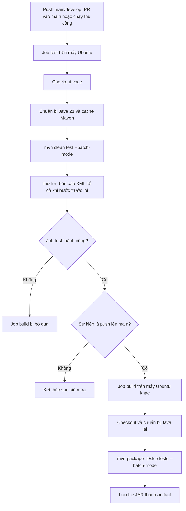

# Hiểu CI của TetRail từ đầu, từng dòng

Tài liệu này giải thích đúng file `.github/workflows/ci.yml` hiện tại có 65 dòng. Workflow được giữ nguyên để bạn đối chiếu; đây là hướng dẫn đọc, không phải một bản CI mới.

## 1. CI giải quyết việc gì?

Bạn sửa Java trên máy mình và chạy test. Nhưng máy bạn có thể còn class cũ, dùng JDK khác hoặc có file chưa commit. Người khác tải code từ GitHub có thể không chạy được như bạn.

CI là viết tắt của Continuous Integration, thường gọi là tích hợp liên tục. Trong project này, mỗi sự kiện phù hợp trên GitHub sẽ khiến một máy do GitHub cung cấp tải code, chuẩn bị Java, rồi chạy lệnh Maven. Nhờ vậy bạn có một lần kiểm tra tự động trên code đã gửi lên repository.

CI không tự hiểu nghiệp vụ bán vé. Nó chạy đúng những lệnh và test mà bạn cấu hình. Nếu chưa có test kiểm tra một lỗi thì CI vẫn có thể xanh khi lỗi đó còn tồn tại.

## 2. Sáu từ cần hiểu trước khi đọc YAML

| Từ | Nghĩa trong project |
| --- | --- |
| Workflow | Toàn bộ quy trình trong `ci.yml`. |
| Event | Sự kiện bắt đầu quy trình: push, pull request hoặc yêu cầu chạy thủ công. |
| Job | Một nhóm công việc trên runner; file này có `test` và `build`. |
| Runner | Máy thực hiện job, ở đây là máy Ubuntu do GitHub cung cấp. |
| Step | Một bước bên trong job: tải code, cài Java, chạy Maven, tải report lên. |
| Action | Thành phần viết sẵn được gọi bằng `uses`, như `actions/checkout@v4`. |

Workflow nằm trong thư mục `.github/workflows` để GitHub Actions nhận diện. YAML mô tả việc cần làm; nó không phải code Java và không chạy bên trong Spring Boot. [Khái niệm workflow của GitHub](https://docs.github.com/en/actions/concepts/workflows-and-actions/workflows).

## 3. Nhìn toàn bộ luồng trước



Tải report thất bại cũng có thể khiến job thất bại; kết quả job không chỉ phụ thuộc test. `always()` cho phép thử chạy bước đó, không bảo đảm sẽ có file để tải lên.

## 4. Cách đọc cú pháp YAML

```yaml
jobs:
  test:
    steps:
      - name: Checkout repository
        uses: actions/checkout@v4
```

`key: value` là tên thuộc tính và giá trị. Dòng kết thúc bằng dấu `:` như `jobs:` mở một nhóm bên dưới. Thụt lề bằng dấu cách cho biết dòng thuộc nhóm nào. Dấu `-` bắt đầu một phần tử danh sách; ở đây là một step. `#` bắt đầu comment, dùng cho người đọc. Dòng trắng để dễ nhìn, không tạo công việc mới.

`name` xuất hiện ở nhiều chỗ vì nó đặt tên cho những đối tượng khác nhau: workflow, job, step hoặc artifact. Vị trí thụt lề giúp biết đang đặt tên cho cái gì.

`uses` gọi action viết sẵn. `run` chạy lệnh shell. `with` truyền tham số cho action ngay phía trên. Không đặt tham số `with` của action này lẫn sang action khác.

## 5. Giải thích đủ 65 dòng

Số dòng dưới đây khớp file hiện tại. Những dòng lặp vẫn được ghi rõ để bạn không phải đoán.

### Dòng 1–10: tên và thời điểm chạy

| Dòng | Nội dung | Ý nghĩa và lý do |
| --- | --- | --- |
| 1 | `name: TetRail CI - Auto Test & Build` | Tên cả workflow hiển thị trong tab Actions. Bạn có thể đổi tên mà không đổi logic thực thi. |
| 2 | Dòng trắng | Chia tên với cấu hình sự kiện cho dễ đọc. |
| 3 | `on:` | Bắt đầu danh sách sự kiện có thể kích hoạt workflow. |
| 4 | `push:` | Theo dõi việc đẩy commit lên GitHub. Các dòng con giới hạn nhánh được theo dõi. |
| 5 | `branches: [ "main", "develop" ]` | Chỉ push vào `main` hoặc `develop` mới kích hoạt bằng sự kiện push. Dấu ngoặc vuông là cách viết danh sách gọn. |
| 6 | `pull_request:` | Chạy khi mở, mở lại PR hoặc cập nhật commit cho PR phù hợp theo các loại sự kiện mặc định. Không có nghĩa mọi thao tác trên PR đều chạy. |
| 7 | `branches: [ "main" ]` | Lọc nhánh đích của PR: PR muốn merge vào main. Không phải chỉ nhận PR có nhánh nguồn tên main. |
| 8 | `workflow_dispatch:` và comment | Cho phép yêu cầu chạy thủ công qua GitHub. Comment phía sau chỉ giải thích. Điều kiện của job build ở dòng 44 vẫn được áp dụng. |
| 9 | Dòng trắng | Tách sự kiện khỏi danh sách job. |
| 10 | `jobs:` | Bắt đầu khai báo các job của workflow. |

Ví dụ PR `feature/booking-validation → main` phù hợp dòng 7. Push lên nhánh feature khi chưa có PR phù hợp thì không đủ điều kiện chạy workflow này. Quy tắc sự kiện được mô tả trong [tài liệu trigger của GitHub](https://docs.github.com/en/actions/reference/workflows-and-actions/events-that-trigger-workflows).

### Dòng 11–26: chuẩn bị job test

| Dòng | Nội dung | Ý nghĩa và lý do |
| --- | --- | --- |
| 11 | Comment kiểm tra biên dịch và Unit Tests | Ghi chú cho người đọc. Thực tế bộ test hiện tại còn có test Spring/database, không chỉ unit test. Comment không điều khiển loại test. |
| 12 | Dòng trắng | Tách ghi chú và job. |
| 13 | `test:` | ID của job thứ nhất. Dòng `needs: test` về sau tham chiếu đúng ID này. |
| 14 | `name: Run Unit Tests` | Tên hiển thị của job. Đổi tên này không thay đổi test được chạy. |
| 15 | `runs-on: ubuntu-latest` | Yêu cầu runner Ubuntu do GitHub cung cấp. `latest` là nhãn ảnh môi trường được GitHub cập nhật, không phải máy Windows của bạn. |
| 16 | Dòng trắng | Tách chọn runner và danh sách step. |
| 17 | `steps:` | Bắt đầu danh sách các bước, chạy theo thứ tự trong job. |
| 18 | `- name: Checkout repository` | Bắt đầu step lấy source code, đặt tên để dễ đọc log. |
| 19 | `uses: actions/checkout@v4` | Gọi action checkout để đưa code của lần chạy vào workspace trên runner. Máy mới cần có source trước khi Maven đọc pom.xml. `@v4` là phiên bản action, không phải Java 4. |
| 20 | Dòng trắng | Tách step checkout và step Java. |
| 21 | `- name: Set up JDK 21` | Bắt đầu step chuẩn bị JDK. |
| 22 | `uses: actions/setup-java@v4` | Gọi action chuẩn bị Java cho các lệnh tiếp theo. |
| 23 | `with:` | Bắt đầu truyền tham số cho setup-java. |
| 24 | `java-version: '21'` | Chọn JDK 21, phù hợp source/target 21 trong pom.xml. Dấu nháy giữ giá trị dưới dạng chuỗi. |
| 25 | `distribution: 'temurin'` | Chọn bản phân phối JDK Eclipse Temurin. Đây là nhà phân phối của JDK, không phải phiên bản Spring. |
| 26 | `cache: maven` và comment | Bật hỗ trợ cache dependency Maven để giảm tải lại thư viện ở những lần chạy sau. Comment `~/.m2` diễn đạt gọn; cache dependency Maven v4 chủ yếu lưu repository thư viện, không phải toàn bộ môi trường ứng dụng. |

Checkout lấy code vào máy chạy job; setup-java chuẩn bị JDK và cấu hình môi trường để lệnh `java`/`javac` dùng phiên bản yêu cầu. [Checkout v4](https://github.com/actions/checkout/tree/v4), [setup-java v4](https://github.com/actions/setup-java/tree/v4).

### Dòng 27–37: chạy test và lưu kết quả

| Dòng | Nội dung | Ý nghĩa và lý do |
| --- | --- | --- |
| 27 | Dòng trắng | Tách chuẩn bị môi trường và thực thi Maven. |
| 28 | `- name: Compile and Run Tests` | Tên step chạy biên dịch và test. |
| 29 | `run: mvn clean test --batch-mode` | Chạy Maven tại thư mục repository gốc. Xóa output cũ, biên dịch và chạy test. Giải thích lệnh ở phần tiếp theo. |
| 30 | Dòng trắng | Tách test và upload report. |
| 31 | `- name: Upload Test Results` | Bắt đầu step lưu file kết quả để bạn tải về đọc. |
| 32 | `if: always()` và comment | Cho phép thử chạy step này cả khi test thất bại. Bình thường step sau lỗi sẽ bị bỏ qua nếu không có điều kiện phù hợp. |
| 33 | `uses: actions/upload-artifact@v4` | Gọi action lưu file từ runner thành artifact của lần chạy workflow. |
| 34 | `with:` | Bắt đầu tham số upload-artifact. |
| 35 | `name: surefire-test-reports` | Tên gói file hiển thị ở phần Artifacts. Không phải tên test hay ID job. |
| 36 | `path: "**/target/surefire-reports/*.xml"` | Tìm các file XML trong thư mục report của các module. `**` đi qua nhiều mức thư mục; `*.xml` chọn file đuôi XML ở thư mục đó. |
| 37 | `retention-days: 7` | Yêu cầu giữ artifact trong 7 ngày, trong giới hạn chính sách của repository/organization. |

Ví dụ file được chọn: `hoang-application/target/surefire-reports/TEST-…BookTicketUseCaseTest.xml`. Pattern không upload file `.txt` trong cùng thư mục. Report XML là dữ liệu kết quả, không tự biến thành một trang báo cáo đẹp.

Nếu compile lỗi trước khi test tạo report, step vẫn được thử chạy nhưng có thể không tìm thấy file. Với cấu hình upload-artifact hiện tại, không tìm thấy file mặc định sẽ cảnh báo. `always()` không làm một test đỏ thành xanh. [Upload Artifact v4](https://github.com/actions/upload-artifact/tree/v4).

### Dòng 38–55: điều kiện và môi trường job build

| Dòng | Nội dung | Ý nghĩa và lý do |
| --- | --- | --- |
| 38 | Dòng trắng | Tách hai job. |
| 39 | Comment `JOB 2` | Ghi chú job đóng gói. Ghi chú chỉ nói test pass; điều kiện đầy đủ còn có dòng 44. |
| 40 | `build:` | ID job thứ hai. |
| 41 | `name: 📦 Package Application` | Tên hiển thị, emoji chỉ để nhận diện. |
| 42 | `needs: test` | Job này phụ thuộc job có ID `test`; theo điều kiện mặc định, chỉ được đi tiếp khi job đó thành công. |
| 43 | `runs-on: ubuntu-latest` | Job build dùng runner Ubuntu riêng; không dùng lại workspace của job test. |
| 44 | `if: github.ref == 'refs/heads/main' && github.event_name == 'push'` | Thêm điều kiện: nhánh của sự kiện phải là main và sự kiện phải là push. Cả hai vế phải đúng. |
| 45 | Dòng trắng | Tách điều kiện và steps. |
| 46 | `steps:` | Bắt đầu các bước của job build. |
| 47 | `- name: Checkout repository` | Tên step tải source cho máy thứ hai. |
| 48 | `uses: actions/checkout@v4` | Checkout lại vì `needs` chỉ tạo quan hệ chờ, không copy source hay output từ job trước. |
| 49 | Dòng trắng | Tách hai step. |
| 50 | `- name: Set up JDK 21` | Tên step chuẩn bị Java trên runner build. |
| 51 | `uses: actions/setup-java@v4` | Thực hiện chuẩn bị JDK trên máy build. |
| 52 | `with:` | Bắt đầu tham số của setup-java ở job này. |
| 53 | `java-version: '21'` | Dùng Java 21 nhất quán với job test. |
| 54 | `distribution: 'temurin'` | Dùng bản phân phối Temurin như job test. |
| 55 | `cache: maven` | Cho phép khôi phục cache dependency phù hợp thay vì tải lại tất cả thư viện. Cache không truyền `target/classes` của job test sang. |

Phân tích dòng 44:

```text
github.ref         = thông tin ref của sự kiện
refs/heads/main    = tên đầy đủ của nhánh main
==                 = so sánh bằng
&&                 = và: cả hai điều kiện phải đúng
github.event_name  = tên sự kiện, ví dụ push hoặc workflow_dispatch
```

Đây là biểu thức GitHub Actions, không phải lệnh Bash. `if` cho phép viết biểu thức trực tiếp như file đang có. Xem [cú pháp workflow](https://docs.github.com/en/actions/reference/workflows-and-actions/workflow-syntax).

### Dòng 56–65: tạo và lưu JAR

| Dòng | Nội dung | Ý nghĩa và lý do |
| --- | --- | --- |
| 56 | Dòng trắng | Tách chuẩn bị Java và lệnh đóng gói. |
| 57 | `- name: Package Multi-Module Project` | Tên step đóng gói toàn bộ Maven reactor. |
| 58 | `run: mvn package -DskipTests --batch-mode` | Biên dịch và đóng gói project. Bỏ chạy test ở lần này vì job test trước đó đã kiểm tra. Vẫn phải build lại trên workspace mới. |
| 59 | Dòng trắng | Tách đóng gói và upload JAR. |
| 60 | `- name: Upload Build Artifact` | Tên step lưu JAR sau khi package thành công. |
| 61 | `uses: actions/upload-artifact@v4` | Upload file kết quả lên phần Artifacts của workflow run. |
| 62 | `with:` | Bắt đầu tham số upload. |
| 63 | `name: start-application-jar` | Tên artifact chứa file ứng dụng. |
| 64 | `path: start/target/*.jar` | Chỉ lấy file `.jar` ở module khởi động `start`. Không lấy các JAR module khác. File `.jar.original` không khớp đuôi `.jar`. |
| 65 | `retention-days: 7` | Yêu cầu giữ artifact JAR trong 7 ngày để tải xuống. |

## 6. Hiểu kỹ hai lệnh Maven

### Lệnh kiểm tra

```bash
mvn clean test --batch-mode
```

`mvn` là Maven đã được cài trên runner Ubuntu. Workflow hiện tại không dùng wrapper `mvnw` của repository. `setup-java` chuẩn bị JDK, không phải là bước cài Maven; `mvn` dựa vào công cụ sẵn có trên ảnh runner.

`clean` xóa output build cũ trong target. Nó không xóa code, cũng không xóa cache thư viện `.m2/repository`.

`test` chạy lifecycle đến giai đoạn test, bao gồm biên dịch source và test. Không có nghĩa nó chạy mọi phương thức Java: test phải được test runner/plugin tìm thấy.

`--batch-mode`, viết ngắn là `-B`, dùng chế độ không tương tác. CI không có người ngồi trả lời câu hỏi trong terminal, nên đây là lựa chọn phù hợp.

### Lệnh đóng gói

```bash
mvn package -DskipTests --batch-mode
```

`package` chạy đến giai đoạn tạo sản phẩm đóng gói. Với module Java ở đây, sản phẩm thường là JAR. Module gốc có `<packaging>pom</packaging>` nên đóng vai trò tập hợp/cấu hình module, không tạo một JAR ứng dụng gốc.

`-DskipTests` đặt thuộc tính Maven để bỏ chạy test trong cấu hình plugin thông thường hiện tại; nó vẫn biên dịch test. Nó khác `-Dmaven.test.skip=true`, thường bỏ cả biên dịch và chạy test.

Maven chạy các giai đoạn theo thứ tự; khi gọi package, nó đi qua các giai đoạn trước package. Tham khảo [lifecycle Maven](https://maven.apache.org/guides/introduction/introduction-to-the-lifecycle.html).

### Vì sao chạy ở thư mục gốc lại xử lý nhiều module?

`pom.xml` gốc liệt kê `start`, `hoang-controller`, `hoang-infrastructure`, `hoang-application`, `hoang-domain`. Maven đọc quan hệ dependency và sắp xếp thứ tự build để module được phụ thuộc được xử lý trước module cần nó. Đây là Maven reactor.

CI không chạy năm lệnh test thủ công vì Maven đã biết cách đi qua các module. Việc này cũng kiểm tra các import và quan hệ dependency sau khi bạn di chuyển DTO/use case.

### JAR ứng dụng được tạo ở đâu?

`start/pom.xml` có `spring-boot-maven-plugin` với goal `repackage`. Khi package, plugin đóng gói lại JAR để có thể chạy ứng dụng Spring Boot với dependency cần thiết. Trong cấu hình hiện tại, file ứng dụng có dạng `start/target/hoang-start-1.0-SNAPSHOT.jar`.

Upload file đó lên GitHub chỉ là lưu sản phẩm build. Workflow chưa có bước triển khai lên máy chủ. Tải JAR về cũng chưa đủ để kết luận chạy production được: ứng dụng còn cần cấu hình runtime và các dịch vụ đang dùng.

## 7. Những test nào thực sự được chạy?

`pom.xml` gốc cấu hình Maven Surefire. Bộ test hiện tại chứa unit test với mock, test controller MockMvc, test khởi tạo Spring và test database H2. Những class như `AuthE2ETest` và `BookingExpirationIntegrationTest` vẫn kết thúc bằng `Test`, nên được Surefire tìm thấy trong cấu hình hiện tại.

Tên job `Run Unit Tests` không giới hạn bộ test chỉ còn unit test. `mvn test` cũng không mặc định chạy tất cả integration test ở mọi project; cách đặt tên và cấu hình Surefire/Failsafe mới quyết định. Project này chưa cấu hình Failsafe riêng trong pom gốc.

Profile Spring `test` trong `start/src/test/resources/application-test.yaml` được chọn bởi `@ActiveProfiles("test")` trên test Spring tương ứng. Workflow không có dòng nào tự ép mọi test dùng profile đó.

Các test Spring hiện có dùng H2 trong bộ nhớ; test gửi mail dùng mock. Vì vậy workflow không khai báo PostgreSQL/SMTP service để phục vụ những test này. Redis cache thật và PostgreSQL thật chưa được chứng minh chỉ bằng việc CI này xanh. File workflow cũng không có bước load test hay quét chất lượng bằng một công cụ riêng.

## 8. Cache và artifact khác nhau thế nào?

Cache Maven giúp tái sử dụng thư viện đã tải, ví dụ Spring hoặc JUnit. Khi phù hợp điều kiện cache, bước setup có thể khôi phục chúng. Cache thiếu thì Maven tải lại; về mục đích, cache hỗ trợ tốc độ chứ không thay thế test.

Artifact là file bạn chủ động giữ sau job: XML report hoặc JAR. Runner là máy tạm nên file chỉ nằm trong workspace không phải cách lưu kết quả cho bạn tải về sau này.

```text
Cache:    thư viện đã tải → phục vụ lần build tiếp theo
Artifact: report/JAR     → để người dùng tải và xem kết quả
```

Hai job không chia sẻ workspace. Muốn truyền một sản phẩm build từ job này sang job khác cần cơ chế upload/download tương ứng. Workflow hiện tại không làm thế; job build tải source rồi tự đóng gói lại. `needs: test` chỉ làm job build chờ kết quả.

## 9. Bảng tự dự đoán workflow

Giả sử workflow đã có trên các nhánh liên quan, Actions được bật và test thành công:

| Việc bạn làm | Workflow được kích hoạt? | Job test | Job build/JAR |
| --- | --- | --- | --- |
| Push lên main | Có | Chạy | Chạy |
| Push lên develop | Có | Chạy | Bỏ qua |
| Push nhánh feature, chưa có PR vào main | Không qua push filter này | Không | Không |
| Mở PR từ feature vào main | Có | Chạy | Bỏ qua |
| Push thêm commit vào PR feature → main | Có qua sự kiện cập nhật PR | Chạy | Bỏ qua |
| Mở PR từ feature vào develop | Không qua pull_request filter này | Không | Không |
| Chạy thủ công và chọn main | Có | Chạy | Bỏ qua vì sự kiện là workflow_dispatch |
| Merge PR vào main | Thông thường tạo push vào main | Chạy trong run của push | Chạy nếu test thành công |

Push lên develop khi develop đồng thời có PR vào main có thể tạo hai lần chạy: một run cho push, một run cho pull_request. Đây là hệ quả của hai trigger cùng phù hợp, không phải Maven tự chạy lặp trong một step.

CI chạy không đồng nghĩa được phép bỏ qua quy trình review. Workflow cũng không tự bật branch protection hay bắt buộc check phải xanh trước khi merge; đó là thiết lập repository riêng.

## 10. Thực hành từng bước trên GitHub

### Bước 1: Đảm bảo code cần kiểm tra đã được gửi lên

Chạy `git status` và xem Diff trong IDE. CI chỉ lấy code của commit/ref trên GitHub, không thấy file mới còn ở máy bạn hay thay đổi chưa commit. Trong buổi làm việc này có nhiều file di chuyển và file mới, nên kiểm tra kỹ cả bản staged lẫn working tree trước khi tự commit.

Không cần thêm database password thật vào workflow để chạy bộ test đang có. Chỉ cấu hình secret khi một bước thực sự cần kết nối dịch vụ tương ứng.

### Bước 2: Mở một PR học tập vào main

Làm thay đổi trên nhánh riêng, kiểm tra diff, commit đúng các file cần thiết và push nhánh đó. Trên GitHub tạo PR với base là main. Workflow này sẽ chạy test cho PR; không cần push thẳng lên main để học cách đọc CI.

### Bước 3: Đọc kết quả

Mở tab Actions của repository, chọn workflow `TetRail CI - Auto Test & Build`, rồi chọn lần chạy gắn với commit/PR. Mở job `Run Unit Tests`. Mở lần lượt các step để xem quá trình chuẩn bị và log Maven.

Đọc kết quả theo phạm vi: step nào lỗi, thuộc job nào, thuộc commit nào. Nếu build bị skipped trên PR thì đó là hành vi đúng theo dòng 44.

### Bước 4: Chạy thủ công

Workflow cần có trên default branch để GitHub cho kích hoạt workflow_dispatch. Với tài khoản có quyền ghi repository, vào Actions, chọn workflow, chọn Run workflow, chọn branch rồi chạy. Vị trí nút có thể thay đổi theo giao diện.

Ở file hiện tại, chọn branch main vẫn không chạy job build, vì sự kiện thủ công không phải push. Bạn có thể dùng cách này để học đọc test/report. [Hướng dẫn chạy thủ công của GitHub](https://docs.github.com/en/actions/how-tos/manage-workflow-runs/manually-run-a-workflow).

### Bước 5: Tải report hoặc JAR

Mở trang tổng quan của lần chạy và tìm Artifacts. `surefire-test-reports` chứa report XML đã tạo. `start-application-jar` chỉ có nếu job build chạy, package và upload thành công. Artifact có thể được tải về dưới dạng gói nén.

Nếu bấm Run workflow nhưng không thấy JAR, hãy kiểm tra job build bị skipped trước khi nghi Maven có lỗi.

## 11. Đọc log đỏ mà không bị ngợp

Đừng chỉ đọc dòng `Process completed with exit code 1`; đó là kết luận lệnh thất bại. Cuộn lên tìm lỗi cụ thể đầu tiên có liên quan.

| Dấu hiệu | Thường nên kiểm tra |
| --- | --- |
| `COMPILATION ERROR`, `cannot find symbol` | Class/import/package thiếu hoặc sai; với lần di chuyển DTO, xem các file mới đã được commit chưa. |
| `Tests run: ..., Failures: 1` | Test mong đợi gì và giá trị thực tế là gì; đọc tên test, dòng lỗi và XML report. |
| `Errors: 1`, `Failed to load ApplicationContext` | Lỗi khởi tạo Spring: tìm phần Caused by có ý nghĩa, bean thiếu, property hay cấu hình môi trường. |
| `Could not resolve dependencies` | Lỗi tải dependency, version không tồn tại hoặc mạng/repository; không vội kết luận logic Java sai. |
| `No files were found` ở upload report | Có thể test chưa chạy vì compile/setup đã lỗi; đọc step trước đó. |
| Test xanh, build skipped trên PR | Đúng điều kiện hiện tại, không phải lỗi. |
| Test xanh nhưng upload đỏ | Lỗi bước lưu artifact vẫn có thể làm job đỏ. |

Đối với project nhiều module, xem `Reactor Summary` để biết module đầu tiên thất bại. Những module sau có thể bị SKIPPED vì phụ thuộc vào module đó.

Khi test đỏ, sửa nguyên nhân hoặc sửa kỳ vọng của test nếu hành vi đã được thay đổi có chủ đích và được kiểm chứng. Không bỏ test chỉ để có dấu xanh.

## 12. Chạy thử ở máy Windows trước khi push

Workflow hiện dùng Maven trên runner. Máy Windows của bạn có Maven Wrapper, nên có thể dùng:

```powershell
# Kiểm tra phiên bản Java và Maven thực tế mà wrapper dùng
.\mvnw.cmd -version

# Tương ứng bước test trong CI
.\mvnw.cmd clean test --batch-mode

# Tương ứng bước package trong CI, sau khi đã chạy test
.\mvnw.cmd package -DskipTests --batch-mode
```

Hoặc dùng lệnh đã chạy trong các bài trước:

```powershell
.\mvnw.cmd -B -ntp clean verify
```

`verify` đi xa hơn `test` trong lifecycle và bao gồm package theo cấu hình hiện có. Nó là kiểm tra cục bộ hữu ích, nhưng không mô phỏng đầy đủ trigger, checkout, runner Ubuntu, action và artifact của GitHub.

Wrapper của project cấu hình Maven 3.9.9 trong `.mvn/wrapper/maven-wrapper.properties`. CI dùng `mvn` sẵn có nên chưa bảo đảm đúng cùng phiên bản Maven đó. Dùng wrapper trong workflow là một cải tiến có thể học sau; cần dùng đúng cách chạy script trên Linux.

Một điểm khác: các lần build trước trên máy này báo Java 23, trong khi CI đặt Java 21. Source/target trong pom là 21 không tự đổi JDK đang chạy trên máy bạn. Vì vậy trước khi so sánh “local xanh, CI đỏ”, kiểm tra `.\mvnw.cmd -version`.

## 13. Đánh giá đúng file CI hiện tại

File đã có nền tảng: sự kiện chạy rõ ràng, JDK được chọn, test chạy trước package, report được giữ khi lỗi và JAR được lưu sau build.

Những lựa chọn cần hiểu rõ trước khi thay đổi:

- PR và develop mới kiểm tra đến test; lỗi chỉ xuất hiện khi package có thể chỉ được phát hiện sau push lên main.
- Chạy thủ công không tạo JAR theo điều kiện hiện tại.
- `mvn` trên runner có thể khác phiên bản wrapper dùng ở local.
- Hai job có bước chuẩn bị lặp lại vì dùng hai máy; tách job giúp phân biệt kiểm tra và đóng gói, nhưng cũng có chi phí build lại.
- Không có deploy, kiểm tra tải lớn hay PostgreSQL thật trong workflow này.

Các tên `@v4` được giải thích theo đúng file đang có. Phiên bản action có vòng đời riêng; trước khi nâng cấp cần đọc release notes của action. Tài liệu setup-java hiện tại đã ghi các bản v1–v4 deprecated. Việc đó khác với phiên bản JDK 21 và không tự chứng minh một run cụ thể đã lỗi. Bài này chưa thay phiên bản action. [Thông tin setup-java hiện tại](https://github.com/actions/setup-java).

## 14. Bài tập tự kiểm tra

1. Vì sao PR vào main chạy test, nhưng không có artifact JAR?
2. Vì sao job build phải checkout lại dù có needs: test?
3. Nếu xóa if: always(), điều gì có thể xảy ra với report khi test fail?
4. cache: maven có lưu code bạn chưa commit không?
5. `name: Run Unit Tests` có làm integration test biến mất không?
6. Vì sao test pass trên máy bạn chưa chắc cùng kết quả với runner Java 21 trên Ubuntu?
7. CI xanh có tự triển khai ứng dụng lên server không?

Trả lời được bằng cách chỉ vào dòng cấu hình cụ thể sẽ giúp bạn hiểu CI thay vì phải ghi nhớ cả file.
