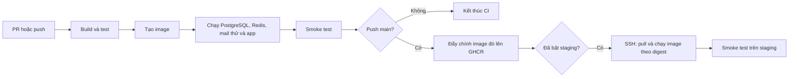

# Tự triển khai CI/CD cho TetRail — từ lý thuyết đến từng file

Tài liệu dành cho người bắt đầu, viết theo code trong `D:\hoang.com` ngày 05/11/2026. Các khối code bên dưới là nội dung để bạn tự tạo/sửa file; việc tạo tài liệu này chưa áp dụng các cấu hình vào ứng dụng và chưa deploy lên server. Làm theo thứ tự, dừng ở mỗi mốc để kiểm tra.

Đích của bài: **Windows local → GitHub Actions → GitHub Container Registry (GHCR) → Ubuntu staging**. Staging dùng dữ liệu thử, mail thử và truy cập qua SSH tunnel. Khi chưa có server, bạn vẫn hoàn thành được toàn bộ phần local, CI và phát hành image.

Cách đọc: mục 1–2 để hiểu luồng; mục 3–9 để chạy local; mục 10–11 để bật CI/publish; mục 12–17 để dựng staging và bật CD; mục 18 để tra lỗi. Mỗi khối code có đường dẫn file hoặc nơi chạy ngay phía trên. Không copy các lệnh server vào terminal Windows.

Kiểm tra tài liệu: cấu hình application/Compose/workflow đã qua parser YAML, 27 khối Bash đã qua kiểm tra cú pháp và Compose đã qua `config --quiet`. Những kiểm tra này chưa chạy Maven, chưa khởi động container và chưa xác nhận deploy trên server. Các mốc kết quả trong bài là tiêu chí để bạn kiểm chứng khi thực hành.

## 1. Hiểu luồng trước khi viết code

Ví dụ bạn sửa chức năng đặt vé:

1. Bạn tạo một nhánh Git, sửa code rồi mở Pull Request (PR) đề nghị gộp vào `main`.
2. GitHub tạo một máy tạm, lấy code của PR về, cài Java, chạy test, tạo JAR và Docker image.
3. Máy tạm chạy image với PostgreSQL, Redis và SMTP thử nghiệm; kiểm tra app có khởi động được không.
4. Nếu thất bại, PR có check đỏ. Khi cấu hình required check, bạn phải sửa trước khi merge.
5. Sau khi merge vào `main`, workflow kiểm tra lại commit trên `main`, rồi phát hành image đã kiểm tra lên GHCR.
6. Khi bạn bật CD, GitHub kết nối SSH đến staging, yêu cầu máy đó tải và chạy image vừa phát hành.



| Từ | Hiểu trong bài này |
|---|---|
| CI — Continuous Integration | Thường xuyên tích hợp thay đổi nhỏ; dùng kiểm tra tự động để phát hiện lỗi |
| Continuous Delivery | Luôn có phiên bản đã kiểm tra, sẵn sàng phát hành; có thể chờ người duyệt trước khi deploy |
| Continuous Deployment | Tự deploy khi vượt qua các điều kiện kiểm tra |
| Pipeline | Chuỗi bước từ code đến bản chạy được |
| Workflow | File YAML mô tả tự động hóa cho GitHub Actions |
| Runner | Máy thực thi job; runner GitHub trong bài là máy Ubuntu tạm |
| Job / step | Job gồm nhiều step chạy tuần tự; các job có thể chạy riêng và phụ thuộc nhau |
| Artifact | Sản phẩm build được lưu lại, ví dụ JAR, báo cáo test, file image |
| Registry | Kho lưu Docker image; GHCR là registry của GitHub |
| Image / container | Image là gói chương trình và runtime; container là phiên chạy từ image |
| Staging / production | Môi trường thử gần thực tế / môi trường phục vụ người dùng thật |
| Smoke test | Kiểm tra nhanh bản chạy được: health UP, API bảo vệ vẫn yêu cầu đăng nhập |
| Rollback | Chuyển ứng dụng về phiên bản trước khi bản mới gây lỗi |

Đây là các khái niệm riêng: `git push` đưa source lên GitHub; `docker push` đưa image lên registry; **deploy** là làm máy đích chạy phiên bản đó.

## 2. Các file sẽ có sau bài thực hành

Đường dẫn dưới đây tính từ `D:\hoang.com`:

```text
hoang.com/
├── .github/workflows/ci.yml          sửa: pipeline CI, publish; thêm CD ở cuối bài
├── .mvn/wrapper/...                  tạo bằng Maven Wrapper
├── mvnw                             tạo bằng Maven Wrapper, chạy trên Linux
├── mvnw.cmd                         tạo bằng Maven Wrapper, chạy trên Windows
├── .gitattributes                   tạo hoặc bổ sung: giữ LF cho script Linux
├── .gitignore                       bổ sung: bỏ qua secret local
├── .dockerignore                    tạo: giới hạn dữ liệu gửi vào Docker build
├── .env.example                     tạo: mẫu biến môi trường, được commit
├── .env                             tạo trên máy bạn, KHÔNG commit
├── Dockerfile                       tạo: đóng gói JAR thành image
├── compose.yaml                     tạo: chạy app + PostgreSQL + Redis + mail thử
├── scripts/
│   ├── smoke.sh                     tạo: kiểm tra ứng dụng qua HTTP
│   └── deploy.sh                    tạo: cập nhật image trên staging
├── start/pom.xml                    sửa: tạo executable JAR
├── start/src/main/resources/application.yaml
│                                    sửa: đọc cấu hình từ biến môi trường
└── hoang-infrastructure/src/main/java/com/hoang/ddd/infrastructure/config/
    └── SecurityConfig.java          sửa: cho phép đọc health
```

**Cách tạo file trong IntelliJ:** nhấp phải thư mục gốc dự án → New → File → nhập đường dẫn tương đối, chẳng hạn `scripts/smoke.sh`. Lưu UTF-8. Script `.sh` dùng line ending LF, chọn ở góc dưới bên phải editor. Mọi file ví dụ đều phải bỏ dấu ``` khi copy.

Trong bài có hai loại terminal: `powershell` chạy trên Windows của bạn; `bash` ở phần server chạy sau khi đã SSH vào Ubuntu. Code `run:` trong YAML do GitHub chạy, bạn không dán cả YAML vào terminal.

## 3. Chuẩn bị Java, Maven Wrapper và Docker

Mở PowerShell ở root dự án:

```powershell
Set-Location D:\hoang.com
java -version
docker version
```

Java phải là 21. Docker cần hiện cả Client và Server; nếu chỉ hiện Client hoặc lỗi kết nối, mở Docker Desktop, chọn Linux containers và đợi engine sẵn sàng. Máy bạn đã có `docker.exe`, nhưng sự tồn tại của lệnh chưa chứng minh engine đang chạy.

Repo chưa có Maven Wrapper. Máy bạn có Maven đi kèm IntelliJ ở đường dẫn dưới đây. Chạy một lần:

```powershell
$tetrailMvn = 'C:\Program Files\JetBrains\IntelliJ IDEA 2026.2.0.1\plugins\maven-plugin\lib\maven3\bin\mvn.cmd'
& $tetrailMvn -version
& $tetrailMvn wrapper:wrapper '-Dmaven=3.9.9'
.\mvnw.cmd -version
```

Nếu IntelliJ đổi thư mục sau khi nâng cấp, cập nhật `$tetrailMvn` theo Maven home trong Settings → Build Tools → Maven. Nếu đã cài Maven trên PATH, dùng `mvn wrapper:wrapper '-Dmaven=3.9.9'`.

Wrapper giữ phiên bản Maven thống nhất giữa máy bạn và CI. `3.9.9` là phiên bản cố định cho bài này, không phải khẳng định bản mới nhất. Lần đầu wrapper tải Maven qua internet; những lần sau dùng bản đã tải. Commit `mvnw`, `mvnw.cmd` và `.mvn/wrapper/`. [Apache Maven Wrapper](https://maven.apache.org/tools/wrapper/).

Tạo hoặc bổ sung **`.gitattributes`**:

```gitattributes
*.sh text eol=lf
mvnw text eol=lf
*.cmd text eol=crlf
```

`LF` và `CRLF` là hai cách kết thúc dòng. Script lưu CRLF có thể gây lỗi `$'\r': command not found` trên Linux. Vẫn chọn LF trong editor cho file `.sh` đang có trên Windows; `.gitattributes` giúp lần checkout sau nhất quán.

## 4. Sửa cách đóng gói JAR

Trong **`start/pom.xml`**, thay nguyên block plugin `spring-boot-maven-plugin` hiện có bằng:

```xml
<plugin>
    <groupId>org.springframework.boot</groupId>
    <artifactId>spring-boot-maven-plugin</artifactId>
    <version>3.3.5</version>
    <executions>
        <execution>
            <goals>
                <goal>repackage</goal>
            </goals>
        </execution>
    </executions>
</plugin>
```

Giữ phần còn lại của file. `repackage` đưa dependency vào JAR và thiết lập entry point để chạy bằng `java -jar`. Root POM của dự án import BOM Spring Boot nhưng không kế thừa `spring-boot-starter-parent`, nên cần khai báo execution này. Version plugin tiếp tục khớp BOM `3.3.5` của dự án. [Spring Boot packaging](https://docs.spring.io/spring-boot/3.3/maven-plugin/packaging.html).

Chạy tại root:

```powershell
.\mvnw.cmd -B -ntp clean verify
jar tf start/target/hoang-start-1.0-SNAPSHOT.jar | Select-String 'BOOT-INF/' | Select-Object -First 5
```

Giải thích Maven:

| Lệnh / phase | Tác dụng |
|---|---|
| `clean` | Xóa output build cũ trong `target`, tránh class cũ làm sai kết quả |
| `compile` | Biên dịch source Java |
| `test` | Chạy các test mà Surefire được cấu hình nhận diện |
| `package` | Đóng gói; phase trước nó, gồm test, cũng chạy |
| `verify` | Đi qua package rồi kiểm tra thêm những plugin đã gắn vào lifecycle |
| `-B` | Batch mode, phù hợp môi trường tự động |
| `-ntp` | Bỏ log tiến độ tải dependency để log dễ đọc |

**`verify` không tự sinh integration test.** Hiện repo chưa cấu hình Failsafe/Testcontainers trong POM. Test profile hiện dùng H2 và tắt Flyway. Phần Docker smoke phía sau sẽ kiểm tra thêm việc khởi động trên PostgreSQL thật và chạy migration; kiểm tra tranh chấp đặt vé/rollback transaction vẫn cần integration test riêng.

Mốc đạt: Maven `BUILD SUCCESS`, tất cả module cần build thành công và lệnh `jar tf` thấy `BOOT-INF/`. Nếu Maven lỗi, tìm module thất bại trong Reactor Summary, đọc test report trong `module/target/surefire-reports/`. Không bỏ qua test bằng `-DskipTests` để đi tiếp.

## 5. Cấu hình ứng dụng bằng biến môi trường

**Vì sao:** cùng một image chạy ở local và staging, nhưng mỗi nơi có DB password/JWT key riêng. Không build mật khẩu vào image. Nếu những secret trước đây trong source từng dùng thật, hãy thay chúng ở môi trường đó; sửa file không thu hồi giá trị đã lộ trong lịch sử Git.

Thay toàn bộ **`start/src/main/resources/application.yaml`** bằng nội dung sau cho bài lab:

```yaml
server:
  port: 8080

spring:
  application:
    name: tetrail-ticketing-system
  datasource:
    url: ${SPRING_DATASOURCE_URL:jdbc:postgresql://localhost:5432/tetrail}
    username: ${SPRING_DATASOURCE_USERNAME:tetrail}
    password: ${SPRING_DATASOURCE_PASSWORD}
    driver-class-name: org.postgresql.Driver
  jpa:
    hibernate:
      ddl-auto: validate
    show-sql: false
    properties:
      hibernate:
        format_sql: false
  flyway:
    enabled: true
    baseline-on-migrate: false
    locations: classpath:db/migration
    validate-on-migrate: true
    out-of-order: false
  data:
    redis:
      host: ${REDIS_HOST:localhost}
      port: ${REDIS_PORT:6379}
      password: ${REDIS_PASSWORD:}
      timeout: 3000ms
  cache:
    type: redis
    redis:
      time-to-live: 600000
      cache-null-values: false
  mail:
    host: ${MAIL_HOST:localhost}
    port: ${MAIL_PORT:1025}
    username: ${MAIL_USERNAME:noreply@tetrail.local}
    password: ${MAIL_PASSWORD:}
    properties:
      mail:
        smtp:
          auth: false
          starttls:
            enable: false
  telegram:
    bot:
      token: ${TELEGRAM_BOT_TOKEN:unused-in-this-lab}

jwt:
  # Base64 cua it nhat 32 byte ngau nhien, theo JwtTokenProvider.
  secret: ${JWT_SECRET}
  expiration: 86400000
  refresh-expiration: 604800000

resilience4j:
  circuitbreaker:
    config:
      default:
        registerHealthIndicator: true
        slidingWindowSize: 10
        permittedNumberOfCallsInHalfOpenState: 3
        minimumNumberOfCalls: 20
        waitDurationInOpenState: 50s
        failureRateThreshold: 50
        eventConsumerBufferSize: 100
  ratelimiter:
    instances:
      backendA:
        limitForPeriod: 2
        limitRefreshPeriod: 10s
        timeoutDuration: 0
        registerHealthIndicator: true
        eventConsumerBufferSize: 100
      backendB:
        limitForPeriod: 6
        limitRefreshPeriod: 500ms
        timeoutDuration: 3s

management:
  health:
    circuitbreakers:
      enabled: true
  endpoints:
    web:
      exposure:
        include: health,info
  endpoint:
    health:
      show-details: never
```

`${NAME:default}` đọc biến môi trường `NAME`, dùng `default` nếu chưa đặt. `${NAME}` không có mặc định: phải cấp giá trị. Test có `application-test.yaml` và `@ActiveProfiles("test")`, nên vẫn dùng datasource/JWT của test.

`ddl-auto: validate` buộc Hibernate kiểm tra schema. Flyway chịu trách nhiệm thay đổi schema bằng migration đã lưu trong Git. `baseline-on-migrate: false` dành cho **DB mới của lab**; không dùng cấu hình này để tự tiếp quản một DB cũ chưa có lịch sử Flyway mà chưa kiểm tra baseline.

Mail trong bài dùng SMTP thử nghiệm nội bộ, không auth/TLS. Nếu chuyển sang nhà cung cấp mail thật, cần cấu hình lại auth/TLS theo nhà cung cấp. Telegram không nằm trong luồng thực hành này. Các giá trị resilience giữ theo cấu hình hiện có, không phải một bài tuning resilience.

Trong **`hoang-infrastructure/src/main/java/com/hoang/ddd/infrastructure/config/SecurityConfig.java`**, tìm đoạn `.authorizeHttpRequests(...)` và thay riêng đoạn đó bằng:

```java
.authorizeHttpRequests(auth -> auth
        .requestMatchers("/actuator/health").permitAll()
        .requestMatchers(
                "/api/auth/register",
                "/api/auth/login",
                "/api/auth/refresh",
                "/api/auth/logout"
        ).permitAll()
        .anyRequest().authenticated())
```

Chỉ health được public để script kiểm tra không cần token. `show-details: never` chỉ trả trạng thái, tránh công khai thông tin kết nối. Các API còn lại tiếp tục qua security rule của chúng.

## 6. Tạo Dockerfile và Docker build context

Tạo **`Dockerfile`** tại root:

```dockerfile
FROM eclipse-temurin:21-jre-jammy
WORKDIR /app
RUN groupadd --gid 10001 app && useradd --uid 10001 --gid app --no-create-home app
COPY --chown=10001:10001 start/target/hoang-start-1.0-SNAPSHOT.jar /app/app.jar
USER 10001:10001
EXPOSE 8080
ENTRYPOINT ["java", "-jar", "/app/app.jar"]
```

| Dòng | Vì sao có |
|---|---|
| `FROM ...21-jre...` | App Java 21 cần runtime Java 21; Maven đã biên dịch ở bước trước |
| `WORKDIR /app` | Đặt thư mục làm việc bên trong image |
| `RUN groupadd...` | Tạo tài khoản chạy app riêng |
| `COPY ...` | Đưa đúng JAR vừa build và test vào image |
| `USER ...` | App chạy bằng user thường trong container |
| `EXPOSE 8080` | Mô tả port app; chưa mở port ra máy host |
| `ENTRYPOINT [...]` | Lệnh container chạy khi khởi động; JVM nhận được tín hiệu dừng |

Tạo **`.dockerignore`** tại root:

```dockerignore
**
!start/
!start/target/
!start/target/hoang-start-1.0-SNAPSHOT.jar
!Dockerfile
!.dockerignore
```

Docker build context là tập file được gửi cho Docker để build. Allowlist này chỉ cho JAR và các file build cần thiết đi vào context; `.env`, `.git` và source không cần gửi. Vì vậy bạn phải build JAR **trước** `docker build`. Nếu đổi `artifactId`/version trong Maven thì cũng cập nhật đường dẫn JAR này.

## 7. Chạy app, PostgreSQL, Redis và mail thử bằng Compose

Tạo **`compose.yaml`** tại root:

```yaml
services:
  postgres:
    image: postgres:16-alpine
    restart: unless-stopped
    environment:
      POSTGRES_DB: tetrail
      POSTGRES_USER: tetrail
      POSTGRES_PASSWORD: ${POSTGRES_PASSWORD:?Set POSTGRES_PASSWORD}
    volumes:
      - pgdata:/var/lib/postgresql/data
    healthcheck:
      test: ["CMD-SHELL", "pg_isready -U $$POSTGRES_USER -d $$POSTGRES_DB"]
      interval: 5s
      timeout: 3s
      retries: 20

  redis:
    image: redis:7-alpine
    restart: unless-stopped
    healthcheck:
      test: ["CMD", "redis-cli", "ping"]
      interval: 5s
      timeout: 3s
      retries: 20

  mailpit:
    image: axllent/mailpit:v1.27.4
    restart: unless-stopped
    ports:
      - "127.0.0.1:8025:8025"

  app:
    image: ${APP_IMAGE:?Set APP_IMAGE}
    restart: unless-stopped
    ports:
      - "127.0.0.1:8080:8080"
    environment:
      SPRING_DATASOURCE_URL: jdbc:postgresql://postgres:5432/tetrail
      SPRING_DATASOURCE_USERNAME: tetrail
      SPRING_DATASOURCE_PASSWORD: ${POSTGRES_PASSWORD:?Set POSTGRES_PASSWORD}
      REDIS_HOST: redis
      JWT_SECRET: ${JWT_SECRET:?Set JWT_SECRET}
      MAIL_HOST: mailpit
      MAIL_PORT: "1025"
    depends_on:
      postgres:
        condition: service_healthy
      redis:
        condition: service_healthy
      mailpit:
        condition: service_started

volumes:
  pgdata:
```

Các image version trên là lựa chọn cho lab, không phải khẳng định bản mới nhất. Các tag major như `16-alpine` có thể trỏ đến nội dung mới theo thời gian; production cần quy trình kiểm tra cập nhật và pin digest phù hợp.

App gọi `postgres:5432`, `redis:6379`, `mailpit:1025` thông qua DNS của mạng Compose. **`localhost` trong app container là app container**, không phải PostgreSQL container và cũng không phải máy Windows.

`127.0.0.1:8080:8080` nối port 8080 của máy host với port 8080 trong container nhưng chỉ nhận kết nối trên loopback của host. PostgreSQL/Redis không có `ports`, nên không được công bố trực tiếp ra host. `pgdata` lưu DB ngoài vòng đời container. Redis chỉ làm cache trong lab nên có thể tái tạo dữ liệu cache.

`depends_on` kết hợp `service_healthy` chờ DB/Redis sẵn sàng trước khi tạo app. `$$` giữ dấu `$` để shell trong PostgreSQL container đọc biến, thay vì Compose nội suy sớm. [Docker startup order](https://docs.docker.com/compose/how-tos/startup-order/).

Mailpit nhận SMTP ở 1025 và cho bạn đọc mail ở 8025. Nó giữ email thử trong môi trường lab, không chuyển thư đến hộp thư bên ngoài. [Mailpit Docker](https://mailpit.axllent.org/docs/install/docker/).

## 8. Tạo .env và chạy thử local

Bổ sung cuối **`.gitignore`**:

```gitignore
# Local environment and deployment credentials
.env
.env.*
!.env.example
.ci.env
*.pem
*.key
```

Tạo **`.env.example`**:

```dotenv
APP_IMAGE=tetrail:local
POSTGRES_PASSWORD=replace-with-random-local-password
JWT_SECRET=replace-with-base64-of-32-random-bytes
```

`.env.example` chỉ là mẫu có thể commit. Tạo `.env` thật bằng PowerShell dưới đây. Chỉ chạy lần đầu; script chủ động từ chối ghi đè `.env` để không vô tình đổi password/JWT key đang dùng:

```powershell
if (Test-Path .env) { throw '.env already exists; keep the existing values.' }
$tetrailRng = [System.Security.Cryptography.RandomNumberGenerator]::Create()
$tetrailJwtBytes = New-Object byte[] 32
$tetrailPasswordBytes = New-Object byte[] 24
$tetrailRng.GetBytes($tetrailJwtBytes)
$tetrailRng.GetBytes($tetrailPasswordBytes)
$tetrailRng.Dispose()
$tetrailJwt = [Convert]::ToBase64String($tetrailJwtBytes)
$tetrailPassword = [Convert]::ToBase64String($tetrailPasswordBytes)
@(
    'APP_IMAGE=tetrail:local'
    "POSTGRES_PASSWORD=$tetrailPassword"
    "JWT_SECRET=$tetrailJwt"
) | Set-Content -Encoding ascii .env
```

`JwtTokenProvider` của dự án decode Base64 nên key tạo theo cách trên phù hợp. Không đưa nội dung `.env` vào commit hoặc log chia sẻ. Compose tự đọc `.env` trong thư mục dự án; Spring Boot chạy trực tiếp từ IntelliJ **không tự đọc file này**. Khi chạy IDE, bạn phải đặt biến ở Run Configuration và cấu hình DB/Redis tương ứng.

Chạy từng lệnh, chỉ tiếp tục nếu lệnh trước thành công:

```powershell
.\mvnw.cmd -B -ntp clean verify
docker build -t tetrail:local .
docker compose -p tetrail-local config --quiet
docker compose -p tetrail-local up -d
docker compose -p tetrail-local ps
docker compose -p tetrail-local logs --tail 100 app
```

`-p tetrail-local` đặt tên Compose project; mạng/volume được đặt theo project này. `up -d` khởi động nền. `config --quiet` kiểm tra cấu hình mà không in secret đã nội suy. App có thể cần vài chục giây khởi động và chạy Flyway. Đọc log rồi gọi:

```powershell
Invoke-RestMethod http://127.0.0.1:8080/actuator/health
curl.exe -s -o NUL -w '%{http_code}' http://127.0.0.1:8080/api/auth/me
```

Kỳ vọng lần lượt `status: UP` và `401`. Dùng `curl.exe` rõ tên vì Windows PowerShell có thể ánh xạ `curl` thành lệnh khác. Mở `http://127.0.0.1:8025` để xem hộp thư thử.

Có thể kiểm tra đăng ký, đăng nhập bằng tài khoản mới:

```powershell
$tetrailUser = 'lab_' + [DateTimeOffset]::UtcNow.ToUnixTimeMilliseconds()
$tetrailTestPassword = 'Learning-Only-Password-2026!'
$tetrailRegister = @{
    username = $tetrailUser
    email = "$tetrailUser@example.test"
    password = $tetrailTestPassword
} | ConvertTo-Json
Invoke-RestMethod -Method Post -Uri http://127.0.0.1:8080/api/auth/register -ContentType 'application/json' -Body $tetrailRegister
$tetrailLoginBody = @{
    usernameOrEmail = $tetrailUser
    password = $tetrailTestPassword
} | ConvertTo-Json
$tetrailLogin = Invoke-RestMethod -Method Post -Uri http://127.0.0.1:8080/api/auth/login -ContentType 'application/json' -Body $tetrailLoginBody
Invoke-RestMethod -Uri http://127.0.0.1:8080/api/auth/me -Headers @{Authorization = "Bearer $($tetrailLogin.accessToken)"}
```

Mốc đạt: `/me` trả về đúng tài khoản vừa tạo; mail đăng ký xuất hiện ở Mailpit nếu luồng đăng ký gửi mail. Đây là kiểm tra thủ công bổ sung, không phải toàn bộ kiểm thử đặt vé.

Dừng local khi không dùng:

```powershell
docker compose -p tetrail-local down
```

Lệnh này giữ DB volume. **Không thêm `-v` nếu muốn giữ dữ liệu.** Đổi `POSTGRES_PASSWORD` trong `.env` không tự đổi password của DB đã khởi tạo trong volume cũ. Với volume đã có, phải thay password bên trong PostgreSQL theo quy trình quản trị hoặc chủ động reset DB lab.

## 9. Viết smoke test dùng chung cho CI và staging

Tạo **`scripts/smoke.sh`**, lưu LF:

```bash
#!/usr/bin/env bash
set -euo pipefail

base_url="${1:-http://127.0.0.1:8080}"
health_file="$(mktemp)"
trap 'rm -f "$health_file"' EXIT

for attempt in $(seq 1 30); do
  if curl --fail --silent --show-error --max-time 5 \
      "$base_url/actuator/health" -o "$health_file" \
      && jq -e '.status == "UP"' "$health_file" >/dev/null; then
    status="$(curl --silent --show-error --max-time 5 \
      --output /dev/null --write-out '%{http_code}' \
      "$base_url/api/auth/me")"
    if [[ "$status" != "401" ]]; then
      echo "Smoke failed: unauthenticated /api/auth/me returned $status, expected 401."
      exit 1
    fi
    echo "Smoke passed: health UP, protected API returns 401."
    exit 0
  fi
  echo "Waiting for app: attempt $attempt/30"
  sleep 5
done

echo "Smoke failed: app did not become healthy in time."
exit 1
```

`curl` gọi HTTP; `jq` đọc JSON để kiểm tra `status` thực sự bằng `UP`. Chỉ kiểm tra HTTP 200 có thể bỏ sót response sai nội dung. Vòng lặp thử có giới hạn vì app cần thời gian boot. `exit 1` báo thất bại cho CI. `set -euo pipefail` giúp script dừng khi lỗi lệnh, biến chưa đặt hoặc pipeline bị lỗi. `trap` dọn file tạm khi kết thúc.

Script này cần Bash, curl, jq trên **máy gọi HTTP**, không cần cài chúng trong image app. Nó không tạo dữ liệu nghiệp vụ, và chưa chứng minh đặt vé đồng thời hoạt động.

## 10. Tạo CI và phát hành image lên GHCR

Thay **toàn bộ `.github/workflows/ci.yml`** bằng YAML dưới đây. Dùng đúng file hiện có để tránh giữ hai workflow trùng nhau. Mẫu sử dụng major `v4` của các action đã có trong repo; đây không phải tuyên bố về bản mới nhất. Khi quản lý production, pin action bằng commit SHA đã xác minh và cập nhật có kiểm tra.

```yaml
name: TetRail CI-CD

on:
  pull_request:
    branches: [main, develop]
  push:
    branches: [main, develop]
  workflow_dispatch:

permissions:
  contents: read

concurrency:
  group: tetrail-${{ github.workflow }}-${{ github.ref }}
  cancel-in-progress: false

jobs:
  verify:
    name: Verify TetRail
    runs-on: ubuntu-24.04
    timeout-minutes: 25
    steps:
      - uses: actions/checkout@v4
        with:
          persist-credentials: false

      - uses: actions/setup-java@v4
        with:
          distribution: temurin
          java-version: '21'
          cache: maven

      - name: Build and test all modules
        run: bash ./mvnw -B -ntp clean verify

      - name: Upload test reports
        if: always()
        uses: actions/upload-artifact@v4
        with:
          name: test-reports
          path: |
            **/target/surefire-reports/**
            **/target/failsafe-reports/**
          if-no-files-found: warn
          retention-days: 7

      - name: Build runtime image
        run: |
          docker build \
            --label "org.opencontainers.image.source=https://github.com/$GITHUB_REPOSITORY" \
            --label "org.opencontainers.image.revision=$GITHUB_SHA" \
            -t "tetrail-ci:$GITHUB_SHA" .

      - name: Create temporary lab configuration
        run: |
          umask 077
          printf 'APP_IMAGE=tetrail-ci:%s\n' "$GITHUB_SHA" > .ci.env
          printf 'POSTGRES_PASSWORD=%s\n' "$(openssl rand -hex 24)" >> .ci.env
          printf 'JWT_SECRET=%s\n' "$(openssl rand -base64 32)" >> .ci.env

      - name: Start app and dependencies
        run: docker compose --env-file .ci.env -p tetrail-ci up -d

      - name: Check running application
        run: bash scripts/smoke.sh

      - name: Print app logs on failure
        if: failure()
        run: |
          if [ -f .ci.env ]; then
            docker compose --env-file .ci.env -p tetrail-ci logs --tail 150 app
          fi

      - name: Stop temporary environment
        if: always()
        run: |
          if [ -f .ci.env ]; then
            docker compose --env-file .ci.env -p tetrail-ci down --volumes
          fi

      - name: Save the tested image
        if: github.event_name == 'push' && github.ref == 'refs/heads/main'
        run: docker save "tetrail-ci:$GITHUB_SHA" -o "$RUNNER_TEMP/tetrail-image.tar"

      - name: Upload image for publishing job
        if: github.event_name == 'push' && github.ref == 'refs/heads/main'
        uses: actions/upload-artifact@v4
        with:
          name: tested-image
          path: ${{ runner.temp }}/tetrail-image.tar
          compression-level: 0
          retention-days: 1

  publish:
    name: Publish tested image
    needs: verify
    if: github.event_name == 'push' && github.ref == 'refs/heads/main'
    runs-on: ubuntu-24.04
    timeout-minutes: 15
    permissions:
      contents: read
      packages: write
    outputs:
      image: ${{ steps.release.outputs.image }}
    steps:
      - uses: actions/download-artifact@v4
        with:
          name: tested-image
          path: ${{ runner.temp }}/tested-image

      - name: Load tested image
        run: docker load -i "$RUNNER_TEMP/tested-image/tetrail-image.tar"

      - name: Log in to GHCR
        env:
          GHCR_TOKEN: ${{ secrets.GITHUB_TOKEN }}
        run: printf '%s' "$GHCR_TOKEN" | docker login ghcr.io -u "$GITHUB_ACTOR" --password-stdin

      - name: Publish and record immutable image reference
        id: release
        run: |
          IMAGE="ghcr.io/${GITHUB_REPOSITORY,,}:$GITHUB_SHA"
          docker tag "tetrail-ci:$GITHUB_SHA" "$IMAGE"
          docker push "$IMAGE"
          DIGEST_REF="$(docker image inspect --format '{{index .RepoDigests 0}}' "$IMAGE")"
          [[ "$DIGEST_REF" =~ ^ghcr.io/.+@sha256:[a-f0-9]{64}$ ]]
          echo "image=$DIGEST_REF" >> "$GITHUB_OUTPUT"
          printf 'Published image: `%s`\n' "$DIGEST_REF" >> "$GITHUB_STEP_SUMMARY"

      - name: Log out of registry
        if: always()
        run: docker logout ghcr.io
```

Pipeline gồm hai job có trách nhiệm cụ thể:

| Đoạn | Giải thích |
|---|---|
| `pull_request.branches` | Chạy khi PR hướng đến các nhánh này, không phải tên nhánh nguồn |
| `push.branches` | Chạy khi có commit được push/merge vào main hoặc develop |
| `workflow_dispatch` | Cho phép Run workflow thủ công khi workflow đã có trên default branch; mẫu này chỉ kiểm tra ở lần chạy thủ công |
| `checkout` | Lấy code xuống runner; `persist-credentials: false` không giữ token trong Git config |
| `setup-java` | Cài Java 21; cache tải dependency Maven giúp giảm thời gian, không thay cho test |
| `verify` | Chạy Maven, build image, khởi động và smoke test |
| `always()` | Vẫn lưu report/dọn môi trường khi bước trước lỗi |
| `down --volumes` | Xóa DB thử trên runner tạm; đây không phải lệnh dùng trên staging |
| `needs: verify` | Publish chỉ chạy sau khi verify thành công |
| `docker save/load` | Chuyển đúng image đã smoke test sang runner của job publish |
| `packages: write` | Chỉ job publish có quyền ghi package; job chạy code PR không được cấp quyền này |
| `GITHUB_TOKEN` | Token do GitHub cấp cho job, không phải secret bạn tự tạo |
| `${GITHUB_REPOSITORY,,}` | Bash đổi `Owner/Repo` thành chữ thường theo định dạng tên image |
| `outputs.image` | Cho job deploy lấy đúng digest của phiên bản vừa publish |

Job mới là máy mới: nó không tự thấy file/image của job trước, vì thế phải upload/download artifact. Cách save/load này tốn băng thông nhưng giúp bài học rõ ràng: **image được publish chính là image đã chạy smoke test**, không build lại một image khác trong job publish.

Tag chứa commit SHA giúp tra code, nhưng tag vẫn có thể bị ghi đè. Digest `sha256:...` xác định nội dung image. Đây là lý do CD nhận digest thay vì chọn `latest`. GHCR cho phép workflow publish bằng `GITHUB_TOKEN`, server đọc image private bằng credential có quyền đọc package. [GitHub Container Registry](https://docs.github.com/en/packages/working-with-a-github-packages-registry/working-with-the-container-registry).

`cancel-in-progress: false` để lần deploy đang chạy không bị hủy giữa chừng khi có commit mới; các run cùng nhánh dùng cùng nhóm. GitHub có thể thay thế run đang chờ bằng run mới hơn, vì vậy không giả định mọi commit đều được deploy. Tránh bấm re-run một run main cũ sau khi đã deploy bản mới nếu không chủ động muốn quay về bản đó. [GitHub workflow syntax](https://docs.github.com/en/actions/reference/workflows-and-actions/workflow-syntax).

## 11. Đưa file lên GitHub và đọc kết quả

Từ root trong PowerShell, tạo nhánh nếu chưa có nhánh thực hành:

```powershell
git switch -c learning/ci-cd
git status --short
```

Repo hiện có một số thay đổi nghiệp vụ/test của bạn. Kiểm tra chúng và commit riêng khi phù hợp. CI chỉ nhìn thấy nội dung đã commit/push, không thấy file chưa commit trên máy bạn. Nếu test mới phụ thuộc `TimeConfig.java`, chẳng hạn, phải bảo đảm class đó cũng có trong commit tương ứng.

Stage đúng các file của bài này:

```powershell
git add .github/workflows/ci.yml .mvn/wrapper mvnw mvnw.cmd .gitattributes .gitignore .dockerignore .env.example Dockerfile compose.yaml scripts/smoke.sh start/pom.xml start/src/main/resources/application.yaml hoang-infrastructure/src/main/java/com/hoang/ddd/infrastructure/config/SecurityConfig.java
git diff --cached --stat
git diff --cached --name-only
```

Không được có `.env` trong danh sách. Xem diff trong IDE để kiểm tra nội dung, rồi:

```powershell
git commit -m "Add CI checks and publish verified container image"
git push -u origin learning/ci-cd
```

Trên GitHub, mở repo → Pull requests → New pull request → base `main`, compare `learning/ci-cd` → Create pull request. Vào tab Actions, chọn run và mở từng step. PR cần `Verify TetRail` xanh; `publish` bị skip là đúng vì đây chưa phải push main.

Khi PR được merge, push main kích hoạt lại pipeline. Job publish cần được quyền ghi GHCR package. Nếu package đã tồn tại nhưng workflow báo permission denied, vào package settings và kiểm tra Actions access/repository liên kết. Đừng đổi repo private thành public chỉ để xử lý lỗi quyền.

Sau khi publish thành công, mở workflow run → Summary. Bạn thấy dòng như:

```text
Published image: ghcr.io/hoangchilll/tetrail-high-scale-railway-ticketing-system@sha256:...
```

Dấu `...` ở đây chỉ là minh họa. Khi deploy, copy **toàn bộ digest thật** trong Summary.

Để CI thực sự chặn merge lỗi, cấu hình Settings → Rules → Rulesets (hoặc Branch protection): target `main`, bật yêu cầu PR và require status checks; chọn `Verify TetRail` sau khi nó đã chạy ít nhất một lần, bật enforcement. Chọn thêm up-to-date nếu muốn PR được kiểm tra với base mới. Khả năng dùng quy tắc phụ thuộc loại repo/gói GitHub. [GitHub protected branches](https://docs.github.com/en/repositories/configuring-branches-and-merges-in-your-repository/managing-protected-branches/about-protected-branches).

Bài tập xác nhận: ở một PR thử, tạm sửa một assertion cho sai → push → quan sát check đỏ và merge bị chặn. Sửa lại assertion rồi push để check xanh. Không merge phần cố ý làm sai.

## 12. Chuẩn bị Ubuntu staging

Phần này cần một máy **Ubuntu 24.04 x86_64/amd64** mà bạn có quyền quản trị, truy cập SSH port 22 được từ GitHub runner. Có thể là VPS hoặc VM được cấp sẵn; cấu hình thực hành nên có khoảng 2 CPU/4 GB RAM và dung lượng đủ cho Docker images. Đây không phải sizing production. Nếu server là ARM64, image amd64 của bài không phù hợp: cần build/test cho kiến trúc đích trước.

Thay `YOUR_SERVER_IP` bằng IP thật. Từ PowerShell, đăng nhập bằng tài khoản quản trị được cấp:

```powershell
ssh ADMIN_USER@YOUR_SERVER_IP
```

Tất cả lệnh dưới đây đến khi ghi “trở lại Windows” đều chạy trong terminal SSH Ubuntu. Với Ubuntu mới chưa cài Docker, thêm repository chính thức và cài Docker:

```bash
sudo apt-get update
sudo apt-get install -y ca-certificates curl jq openssl
sudo install -m 0755 -d /etc/apt/keyrings
sudo curl -fsSL https://download.docker.com/linux/ubuntu/gpg -o /etc/apt/keyrings/docker.asc
sudo chmod a+r /etc/apt/keyrings/docker.asc
echo "deb [arch=$(dpkg --print-architecture) signed-by=/etc/apt/keyrings/docker.asc] https://download.docker.com/linux/ubuntu noble stable" | sudo tee /etc/apt/sources.list.d/docker.list >/dev/null
sudo apt-get update
sudo apt-get install -y docker-ce docker-ce-cli containerd.io docker-buildx-plugin docker-compose-plugin
sudo systemctl enable --now docker
sudo docker version
sudo docker compose version
```

`noble` ở trên là Ubuntu 24.04. Không copy nguyên đoạn cho distro khác. Với máy đã cài Docker từ nguồn khác, làm theo phần xử lý package xung đột của tài liệu chính thức thay vì cài chồng. [Docker Engine trên Ubuntu](https://docs.docker.com/engine/install/ubuntu/).

Tạo user chuyên chạy deploy và thư mục:

```bash
sudo adduser --disabled-password --gecos '' deploy
sudo usermod -aG docker deploy
sudo install -d -m 0755 -o deploy -g deploy /opt/tetrail
sudo install -d -m 0700 -o deploy -g deploy /home/deploy/.ssh
sudo touch /home/deploy/.ssh/authorized_keys
sudo chown deploy:deploy /home/deploy/.ssh/authorized_keys
sudo chmod 600 /home/deploy/.ssh/authorized_keys
```

User thuộc nhóm `docker` có quyền rất mạnh trên host, nên dùng máy staging riêng cho bài và giữ private key deploy kín. Mở SSH theo chính sách mạng của server. Không mở port 5432, 6379, 8080 hay 8025 ra internet cho bài này; app và mail UI sẽ được truy cập qua SSH tunnel.

## 13. Tạo SSH key và xác minh server

Trở lại **PowerShell trên Windows**, tạo thư mục chứa key ngoài repo:

```powershell
$tetrailSshDir = Join-Path $env:USERPROFILE '.ssh'
New-Item -ItemType Directory -Force $tetrailSshDir | Out-Null
$tetrailDeployKey = Join-Path $tetrailSshDir 'tetrail_staging_ed25519'
ssh-keygen -t ed25519 -C 'tetrail-github-actions' -f $tetrailDeployKey
```

Lệnh hỏi passphrase: với mẫu job tự động bên dưới, để trống bằng Enter hai lần. Nếu file đã tồn tại, không ghi đè key đang dùng; chọn tên mới hoặc dùng key hiện có nếu đúng mục đích. File không đuôi là **private key**, file `.pub` là **public key**.

Đọc public key:

```powershell
Get-Content "$tetrailDeployKey.pub"
```

Copy dòng `ssh-ed25519 ...` đó. Trong SSH session quản trị trên server, mở:

```bash
sudo nano /home/deploy/.ssh/authorized_keys
```

Dán public key thành một dòng mới; Ctrl+O → Enter để lưu, Ctrl+X để thoát. Không dán private key vào server. Tiếp theo lấy fingerprint host key bằng session quản trị/server console bạn tin cậy:

```bash
sudo ssh-keygen -lf /etc/ssh/ssh_host_ed25519_key.pub
```

Trên Windows:

```powershell
$tetrailServer = 'YOUR_SERVER_IP'
$tetrailKnownHosts = Join-Path $tetrailSshDir 'tetrail_staging_known_hosts'
ssh-keyscan -t ed25519 $tetrailServer 2>$null | Set-Content -Encoding ascii $tetrailKnownHosts
ssh-keygen -lf $tetrailKnownHosts
```

So sánh fingerprint ở hai nơi; chỉ tiếp tục khi trùng. `ssh-keyscan` tự nó không chứng minh bạn đang nói chuyện với đúng máy chủ. Nội dung `$tetrailKnownHosts` sẽ dùng làm GitHub secret `STAGING_KNOWN_HOSTS`.

Kiểm tra đăng nhập bằng key và đúng host key:

```powershell
ssh -i $tetrailDeployKey -o "UserKnownHostsFile=$tetrailKnownHosts" -o StrictHostKeyChecking=yes "deploy@$tetrailServer"
```

Bạn đang ở shell của `deploy`. Chạy `docker ps` để chắc quyền Docker hoạt động; không cần `sudo`. `exit` để trở lại Windows.

## 14. Viết script deploy

Tạo **`scripts/deploy.sh`** trong repo trên Windows, lưu LF:

```bash
#!/usr/bin/env bash
set -euo pipefail

cd /opt/tetrail
candidate="${1:?Usage: bash deploy.sh ghcr.io/owner/repo@sha256:DIGEST}"

if [[ ! "$candidate" =~ ^ghcr.io/hoangchilll/tetrail-high-scale-railway-ticketing-system@sha256:[a-f0-9]{64}$ ]]; then
  echo "Expected a digest reference from the TetRail GHCR package."
  exit 1
fi

# A manual deployment and a CI deployment must not change this server together.
exec 9>.deploy.lock
flock -n 9 || { echo "Another deployment is in progress."; exit 1; }

export APP_IMAGE="$candidate"
compose() {
  docker compose --env-file .env.staging -p tetrail-staging -f compose.yaml "$@"
}

compose config --quiet
compose pull app

if compose up -d --no-build && bash ./smoke.sh; then
  if [[ -s .current-image ]]; then
    cp .current-image .previous-image
  fi
  printf '%s\n' "$candidate" > .current-image.tmp
  mv .current-image.tmp .current-image
  printf '%s %s\n' "$(date -u +%FT%TZ)" "$candidate" >> deployments.log
  echo "Deployment passed: $candidate"
else
  compose logs --tail 150 app
  echo "Deployment failed. .current-image still records the last successful image."
  echo "Check logs and migration compatibility before a manual rollback."
  exit 1
fi
```

Nếu dùng fork/repo tên khác, sửa regex cho đúng package lowercase của bạn. `flock` ngăn thao tác tay và CI cùng thay app. Script tải image trước khi cập nhật app, kiểm tra HTTP sau khi chạy và chỉ ghi nhận thành công sau smoke test. `.current-image` nghĩa là **bản đạt kiểm tra gần nhất**, không phải cam kết container hiện tại vẫn đang chạy bản đó khi deploy vừa thất bại.

Script cố ý để rollback do người vận hành thực hiện sau khi kiểm tra migration: rollback image không thể tự khôi phục dữ liệu/schema. Với một instance Compose, app có thể gián đoạn khi recreate.

Copy các file cấu hình lên server bằng **PowerShell từ root repo**:

```powershell
scp -i $tetrailDeployKey -o "UserKnownHostsFile=$tetrailKnownHosts" -o StrictHostKeyChecking=yes compose.yaml scripts/smoke.sh scripts/deploy.sh "deploy@${tetrailServer}:/opt/tetrail/"
```

Trong bài này các file vận hành được cấp lên server một lần, CD tự cập nhật **image app**. Nếu sau này sửa Compose/script, phải review rồi copy lại như trên; một `git push` tự nó chưa cập nhật những file này trên server. Rollback image ở phần sau giả định cấu hình server vẫn tương thích.

## 15. Tạo secret staging và cho server quyền đọc image

SSH lại bằng `deploy`, chạy trong `/opt/tetrail`:

```bash
cd /opt/tetrail
if [[ -e .env.staging ]]; then
  echo '.env.staging already exists; keeping it.'
else
  (
    umask 077
    printf 'POSTGRES_PASSWORD=%s\n' "$(openssl rand -hex 24)" > .env.staging
    printf 'JWT_SECRET=%s\n' "$(openssl rand -base64 32)" >> .env.staging
  )
fi
chmod 600 .env.staging
```

`APP_IMAGE` không lưu ở đây vì script deploy nhận nó qua tham số, rồi export cho Compose. Secret staging được tạo riêng với local; file này chỉ user deploy đọc được. Secret DB/JWT không cần đưa vào GitHub vì runner chỉ yêu cầu server đổi image.

Nếu GHCR package private, tạo GitHub Personal Access Token **classic** có `read:packages`, chủ token có quyền đọc package, cấp SSO nếu tổ chức yêu cầu. Trên server đăng nhập bằng user deploy:

```bash
read -rp 'GitHub username: ' GHCR_USER
read -rsp 'Token with read:packages: ' GHCR_READ_TOKEN
printf '\n'
printf '%s' "$GHCR_READ_TOKEN" | docker login ghcr.io -u "$GHCR_USER" --password-stdin
unset GHCR_READ_TOKEN
```

Token nhập không hiện ra terminal và không nằm trong command history. Docker lưu credential cho user deploy; bảo vệ tài khoản đó. Image public có thể pull không cần đăng nhập. Không dùng `GITHUB_TOKEN` tạm của runner làm credential lâu dài cho server. [GHCR authentication](https://docs.github.com/en/packages/working-with-a-github-packages-registry/working-with-the-container-registry).

Deploy bằng tay **một lần** trước khi bật tự động. Copy digest thật từ Summary của job publish:

```bash
cd /opt/tetrail
read -rp 'Paste full published image digest reference: ' TETRAIL_IMAGE
bash ./deploy.sh "$TETRAIL_IMAGE"
```

Kỳ vọng `Smoke passed...` và `Deployment passed...`. Để xem app từ Windows mà không mở public port, chạy trong terminal Windows mới, giữ terminal này mở:

```powershell
$tetrailDeployKey = Join-Path $env:USERPROFILE '.ssh/tetrail_staging_ed25519'
$tetrailKnownHosts = Join-Path $env:USERPROFILE '.ssh/tetrail_staging_known_hosts'
$tetrailServer = 'YOUR_SERVER_IP'
ssh -i $tetrailDeployKey -o "UserKnownHostsFile=$tetrailKnownHosts" -o StrictHostKeyChecking=yes -N -L 18080:127.0.0.1:8080 -L 18025:127.0.0.1:8025 "deploy@$tetrailServer"
```

Trình duyệt trên Windows: `http://127.0.0.1:18080/actuator/health` là health **staging**, `http://127.0.0.1:18025` là mail **staging**. Port khác local giúp bạn không nhầm hai môi trường. `-N` chỉ mở tunnel, nên terminal đứng chờ là bình thường; Ctrl+C đóng tunnel.

## 16. Bật CD trong GitHub Actions

Trên GitHub repo → Settings → Environments → New environment → tên **`staging`**. Giới hạn deployment branch là `main`. Khả năng dùng environment và required reviewers phụ thuộc gói GitHub và repo public/private. [GitHub environments](https://docs.github.com/en/actions/how-tos/deploy/configure-and-manage-deployments/manage-environments).

Trong environment `staging`, tạo:

| Loại | Tên | Giá trị |
|---|---|---|
| Variable | `STAGING_HOST` | IP/hostname server, cùng giá trị dùng khi xác minh host key |
| Variable | `STAGING_USER` | `deploy` |
| Secret | `STAGING_SSH_KEY` | Toàn bộ nội dung private key `tetrail_staging_ed25519`, gồm BEGIN/END |
| Secret | `STAGING_KNOWN_HOSTS` | Nội dung file `tetrail_staging_known_hosts` đã kiểm tra fingerprint |

Dùng editor local mở file key/known_hosts rồi copy vào form GitHub; không dán private key vào chat, source hay issue. `STAGING_SSH_KEY` phải là private key, không phải file `.pub`.

Trong Settings → Secrets and variables → Actions → **Variables cấp repository**, tạo `ENABLE_STAGING` = `true`. Biến bật/tắt này phải ở cấp repository vì điều kiện job được đánh giá trước khi vào environment.

Thêm đoạn sau **cuối `.github/workflows/ci.yml`**, với `deploy-staging:` thụt **hai dấu cách**, ngang `verify:` và `publish:` bên trong `jobs:`. Không tạo thêm key `jobs:` lần thứ hai:

```yaml
  deploy-staging:
    name: Deploy staging
    needs: publish
    if: github.event_name == 'push' && github.ref == 'refs/heads/main' && vars.ENABLE_STAGING == 'true'
    runs-on: ubuntu-24.04
    timeout-minutes: 15
    environment: staging
    permissions: {}
    steps:
      - name: Prepare SSH credentials
        env:
          DEPLOY_KEY: ${{ secrets.STAGING_SSH_KEY }}
          KNOWN_HOSTS: ${{ secrets.STAGING_KNOWN_HOSTS }}
        run: |
          umask 077
          test -n "$DEPLOY_KEY"
          test -n "$KNOWN_HOSTS"
          mkdir -p "$RUNNER_TEMP/tetrail-ssh"
          printf '%s\n' "$DEPLOY_KEY" > "$RUNNER_TEMP/tetrail-ssh/id_ed25519"
          printf '%s\n' "$KNOWN_HOSTS" > "$RUNNER_TEMP/tetrail-ssh/known_hosts"

      - name: Deploy published digest
        env:
          STAGING_HOST: ${{ vars.STAGING_HOST }}
          STAGING_USER: ${{ vars.STAGING_USER }}
          APP_IMAGE: ${{ needs.publish.outputs.image }}
        run: |
          [[ "$STAGING_HOST" =~ ^[a-zA-Z0-9][a-zA-Z0-9.-]*$ ]]
          [[ "$STAGING_USER" =~ ^[a-z_][a-z0-9_-]*$ ]]
          [[ "$APP_IMAGE" =~ ^ghcr.io/[a-z0-9._/-]+@sha256:[a-f0-9]{64}$ ]]
          ssh \
            -i "$RUNNER_TEMP/tetrail-ssh/id_ed25519" \
            -o UserKnownHostsFile="$RUNNER_TEMP/tetrail-ssh/known_hosts" \
            -o StrictHostKeyChecking=yes \
            -o BatchMode=yes \
            -o ConnectTimeout=15 \
            -o ServerAliveInterval=15 \
            -o ServerAliveCountMax=3 \
            "$STAGING_USER@$STAGING_HOST" \
            "bash /opt/tetrail/deploy.sh '$APP_IMAGE'"

      - name: Remove temporary SSH credentials
        if: always()
        run: rm -f "$RUNNER_TEMP/tetrail-ssh/id_ed25519" "$RUNNER_TEMP/tetrail-ssh/known_hosts"
```

`needs: publish` vừa buộc publish thành công vừa lấy digest đúng của run này. Job deploy không cần checkout source hay quyền GitHub API, nên `permissions: {}`. SSH đọc host key đã xác minh; không tắt `StrictHostKeyChecking`. Lệnh cuối chạy script trên server; exit code khác 0 truyền về GitHub và làm job đỏ.

Mẫu giả định SSH port 22 và host IPv4/DNS; nếu dùng port khác/IPv6, phải điều chỉnh cách xác minh host key, regex và tham số SSH nhất quán.

Commit `scripts/deploy.sh` và phần sửa workflow qua PR; sau khi merge, main chạy `verify → publish → deploy-staging`. Nếu bạn bật required reviewer cho environment và gói GitHub hỗ trợ, deploy chờ Approve: đó là bước phê duyệt trong Continuous Delivery. Nếu không chờ người duyệt, staging được triển khai tự động sau khi các kiểm tra đạt.

Lưu ý vận hành: GitHub runner phải có đường mạng SSH đến server. Nếu server chỉ ở mạng nội bộ, cần kết nối mạng riêng/VPN hoặc runner được đặt trong mạng đó; thay tên secret không giải quyết được lỗi mạng. Không dùng runner có quyền server để chạy code PR không tin cậy.

## 17. Kiểm tra CD và thực hành rollback

Tạo một thay đổi nhỏ đã hiểu, mở PR rồi merge. Xem job `Deploy staging` có log `Deployment passed`. SSH vào server:

```bash
cd /opt/tetrail
cat .current-image
cat deployments.log
APP_IMAGE="$(cat .current-image)" docker compose --env-file .env.staging -p tetrail-staging ps
```

So sánh digest trong `.current-image` với digest ở workflow Summary; truy cập health qua tunnel. Thêm một lần phát hành thành công nữa để có `.previous-image`.

**Rollback sau một lần deploy thành công nhưng phát hiện lỗi nghiệp vụ:** xác nhận schema vẫn chạy được với code cũ, sau đó chạy:

```bash
cd /opt/tetrail
rollback_image="$(cat .previous-image)"
bash ./deploy.sh "$rollback_image"
```

**Khôi phục sau một lần deploy bị smoke fail:** `.current-image` chưa bị cập nhật, nên nó giữ bản thành công gần nhất:

```bash
cd /opt/tetrail
last_successful_image="$(cat .current-image)"
bash ./deploy.sh "$last_successful_image"
```

Lần deploy đầu tiên nếu thất bại chưa có bản cũ để quay về. Cần sửa lỗi cấu hình/code và phát hành bản mới. Nếu vừa có migration không tương thích, không tự động chạy image cũ: xem kế hoạch khôi phục DB hoặc migration sửa tiếp. Hãy thử rollback với một thay đổi không đụng schema trước.

Flyway migration đã chạy không tự bị đảo ngược khi đổi image. Cách tiến hóa schema thường dùng: thêm cấu trúc mới tương thích → deploy code chuyển tiếp → chuyển dữ liệu → chỉ xóa cấu trúc cũ sau khi không còn cần rollback. Production phải có backup và diễn tập restore.

## 18. Lỗi thường gặp và cách đọc

| Hiện tượng | Kiểm tra / cách xử lý |
|---|---|
| `mvnw: No such file` | Đã tạo và commit cả wrapper chưa? Runner chỉ thấy file trên Git |
| `no main manifest attribute` | Đã thêm `repackage`, chạy lại clean verify và build lại image chưa? |
| `COPY ... jar not found` | Maven chưa build thành công hoặc tên JAR khác Dockerfile |
| `Could not resolve placeholder JWT_SECRET` | Compose/IDE chưa cấp biến; `.env` không tự nạp vào Spring khi chạy trực tiếp |
| `WeakKeyException` hoặc lỗi Base64 | JWT key phải là Base64 của ít nhất 32 byte, không phải một mật khẩu tùy ý |
| `Connection refused localhost:5432` trong app container | Datasource phải trỏ `postgres`, không phải localhost |
| PostgreSQL password authentication failed | Password của volume cũ khác giá trị mới trong env |
| Flyway hoặc Hibernate validate fail | Đọc migration/schema cụ thể bị lỗi; không đổi `ddl-auto` thành `update` để giấu lỗi |
| Health 401 | Chưa cho phép chính xác `/actuator/health` trong SecurityConfig hoặc image chưa có bản sửa |
| Health 503 | Một dependency chưa khỏe; đọc app log và `docker compose ps`, kiểm tra DB/Redis/mail |
| Health 200 nhưng script fail | JSON không có `status: UP` hoặc API `/me` chưa trả 401 như mong đợi |
| GHCR `denied` khi push | Job có `packages: write` và package liên kết repo/Actions access đúng chưa? |
| GHCR `unauthorized` khi pull trên server | Login bằng user deploy, PAT còn hạn và có `read:packages`/quyền package chưa? |
| `Permission denied (publickey)` | Private key trong GitHub có khớp public key của `/home/deploy/.ssh/authorized_keys` không? |
| Host key verification failed | Kiểm tra host/fingerprint và known_hosts; đừng bỏ xác minh để cho qua |
| SSH timeout | Sai IP/port, firewall hoặc server không thể truy cập từ runner |
| `Cannot connect to Docker daemon` | Docker engine chưa chạy hoặc user chưa có quyền |
| `exec format error` | Image và kiến trúc CPU server không khớp |
| `bind: address already in use` | Host đã có tiến trình chiếm 8080/8025; dừng môi trường xung đột hoặc chỉnh port và smoke URL nhất quán |
| CI xanh nhưng local khác | Commit có thiếu file? Java/Maven có khác? Local volume có dữ liệu cũ còn CI dùng DB mới? |

Đọc **lỗi đầu tiên có ý nghĩa**, không chỉ dòng “Process completed with exit code 1”. Exit code chỉ báo có lỗi; nguyên nhân thường ở log Maven/test/app phía trên.

## 19. Khi nào coi là hoàn thành bài?

- Bạn giải thích được push source, push image và deploy khác nhau ở đâu.
- Từ root chạy clean verify ra JAR executable.
- Compose local khởi động được; health UP, API có bảo vệ trả 401 khi thiếu token.
- Một PR có test sai bị CI phát hiện và quy tắc nhánh chặn merge.
- Main tạo image; bạn chỉ ra được commit và digest của image đó.
- CI smoke test chạy image cùng PostgreSQL thật trước khi cho publish.
- Server chạy đúng digest vừa publish; CD tự gọi script deploy khi được bật.
- Bạn đã thử quay về một image cũ và biết vì sao DB cần kế hoạch riêng.

Mẫu này là nền tảng học staging một máy. Trước production cần kiểm tra nghiệp vụ trên PostgreSQL, cấu hình HTTPS/domain và CORS theo frontend, mail thật, quan sát log/metrics, backup/restore, quản lý secret và chiến lược cập nhật nhiều instance nếu cần hạn chế gián đoạn. Có thể học từng phần sau khi đường đi CI/CD ở đây đã rõ.
